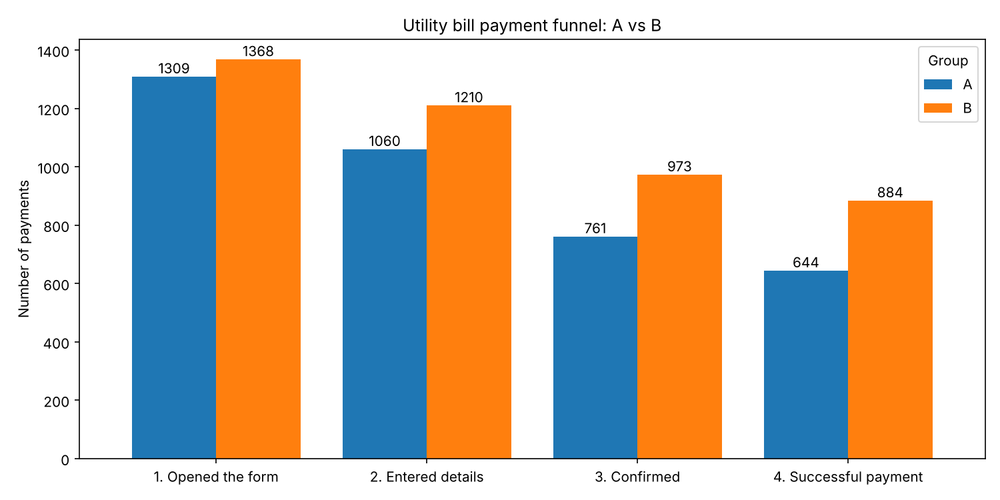
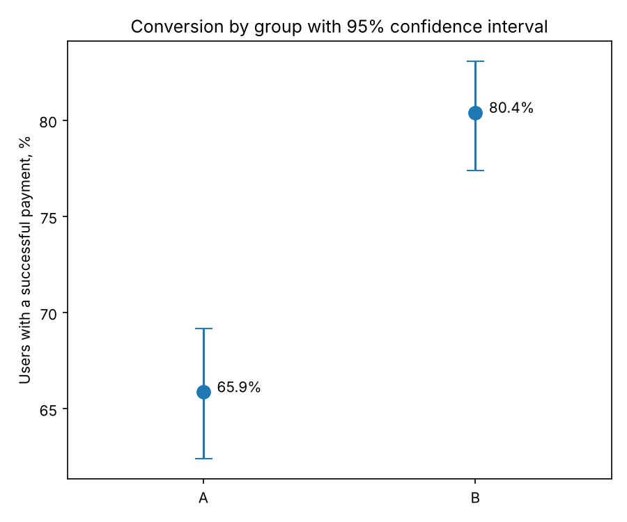
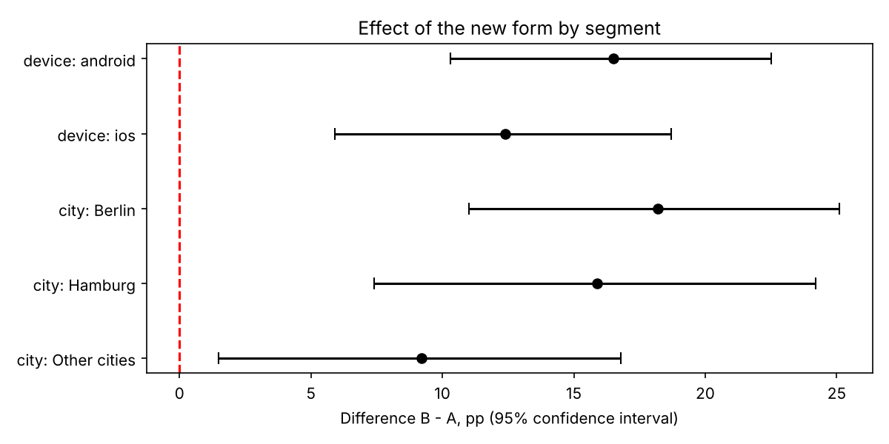

# A/B Test: New Utility Bill Payment Form

Product analytics case study: did a new payment form with autofilled payment details increase the share of successful utility bill payments?

> **Data note:** this is an English adaptation of a real job-application case. The original dataset was not available, so everything here runs on a **synthetic dataset** that mimics its structure and data-quality problems (empty users, impossible ages, test records, group mismatches). Cities are Berlin, Hamburg and Other cities.

## Result (synthetic data)

| Metric | A (old form) | B (new form) | Effect |
|---|---|---|---|
| Users with a successful payment | 65.9% | 80.4% | +14.5 pp (95% CI 10.1 to 18.9), p < 0.001 |
| Successful payments (per attempt) | 49.2% | 64.6% | odds ratio 1.89, p < 0.001 |

The effect is positive on android and ios and in all three city groups (smallest in Other cities, +9.2 pp). **Recommendation: roll out to all users in stages (10% → 50% → 100%)** and monitor payment errors and refunds, which are not present in the data.





## Approach

1. **Cleaning:** removed 4 users and 4 payments (0.15% of payments): missing group/city/user_id, ages of -5 and 150, test ids, group mismatches. Every removal is logged.
2. **EDA:** group balance (chi-square), age, payments per user, funnel, time to payment.
3. **Main test:** two-proportion z-test at the **user** level, because the split was by customers and one user can have several payments.
4. **Robustness check:** logistic regression on payments with standard errors clustered by `user_id`.
5. **Segments:** device and city, with Holm correction for multiple comparisons (exploratory).
6. **Charts:** funnel, conversion with Wilson 95% CI, segment uplift forest plot.

Extra checks on the cleaned data: all payments start within April 1-30, 2024, and funnel timestamps are always in the right order.

## Repository structure

```
├── AB_test_Synthetic_EN.ipynb   # full analysis (with outputs)
├── task/Task_EN.md              # the case description (English)
├── data/
│   ├── AB_test_synthetic.xlsx   # sheets: Users, Pays (synthetic)
│   └── AB_test_synthetic.csv    # copy of the Users sheet
├── images/                      # charts exported by the notebook
├── requirements.txt
└── LICENSE
```

## Running the notebook

```bash
pip install -r requirements.txt
jupyter notebook AB_test_Synthetic_EN.ipynb
```

The notebook reads `data/AB_test_synthetic.xlsx`, writes `clean_synth_data.xlsx` and saves the charts as `viz_*.png` in the working directory.

## Limitations

- Synthetic data, so the numbers illustrate the method and are not real business results.
- No payment errors, refunds or support tickets in the data.
- Stability of the effect by week (novelty effect) was not checked.

## License

MIT
